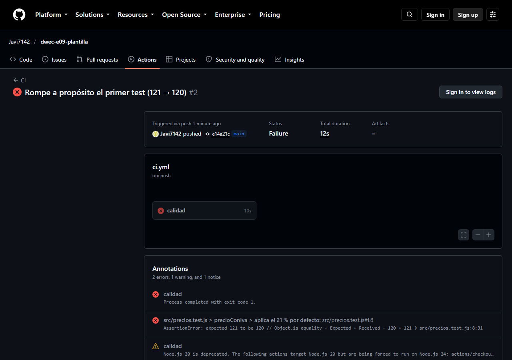
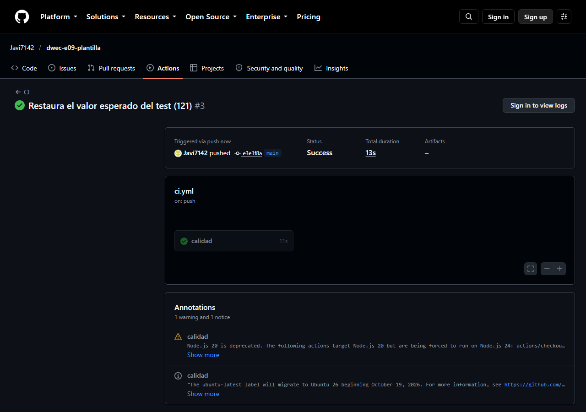

# Plantilla DWEC

Plantilla de proyecto del curso: una calculadora de precios con IVA y descuento, con entorno reproducible (Dev Container), servidor de desarrollo y empaquetado con Vite, análisis de código con ESLint, formato con Prettier, pruebas con Vitest e integración continua con GitHub Actions.

## Requisitos

- Docker y VS Code con la extensión Dev Containers (el entorno ya trae Node.js 24 y npm), **o** Node.js 24 y npm instalados en el equipo.
- Git y una cuenta de GitHub para la integración continua.

## Instalación y ejecución

1. Abre la carpeta del proyecto en VS Code y ejecuta **Dev Containers: Reopen in Container**. El contenedor ejecuta `npm install` solo al crearse.
2. En la terminal del contenedor: `npm run dev`.
3. Abre <http://localhost:5173> (el puerto 5173 se reenvía automáticamente).

Con precio `100`, IVA del 21 % y descuento `10`, la página muestra **Precio final: 108,90 €**; con un descuento de `150`, muestra **❌ El descuento debe estar entre 0 y 100**.

## Scripts

| Script | Orden | Qué hace |
|--------|-------|----------|
| `dev` | `npm run dev` | Arranca el servidor de desarrollo de Vite con recarga en caliente. |
| `build` | `npm run build` | Compila y empaqueta la aplicación para producción en `dist/`. |
| `preview` | `npm run preview` | Sirve el contenido de `dist/` para probar la versión de producción. |
| `test` | `npm test` | Ejecuta Vitest en modo vigilancia (se repite al guardar). |
| `lint` | `npm run lint` | Analiza el código con ESLint y avisa de errores y malas prácticas. |
| `format` | `npm run format` | Da formato a todos los ficheros con Prettier (reescribe los ficheros). |

## Estructura

```text
E09-PlantillaDWEC/
├── .devcontainer/
│   └── devcontainer.json   # Entorno: imagen Node 24, extensiones, puerto 5173, npm install
├── .github/workflows/
│   └── ci.yml              # Integración continua: instala, lint, formato, tests y build
├── img/                    # Capturas de la integración continua
├── src/
│   ├── main.js             # Comportamiento: atiende el formulario y escribe el resultado
│   ├── precios.js          # Lógica: precioConIva y aplicarDescuento
│   ├── precios.test.js     # Once tests de precios.js para Vitest
│   └── style.css           # Presentación: estilos
├── index.html              # Contenido: formulario y resultado; carga /src/main.js
├── eslint.config.js        # Reglas de ESLint
├── .prettierrc             # Opciones de formato: comillas simples, punto y coma, 100 columnas
├── .prettierignore         # Ficheros que Prettier no toca
├── .gitignore              # Ficheros que Git no sube (node_modules/, dist/…)
├── package.json            # Dependencias de desarrollo y scripts
└── package-lock.json       # Versiones exactas instaladas (necesario para npm ci)
```

## Arquitectura

1. **Modelo de aplicación.** Es una aplicación que se ejecuta **en el navegador** (cliente): el código JavaScript se descarga y se ejecuta en la máquina del usuario, y los cálculos no se hacen en ningún servidor. Al servidor (o al hosting estático) solo se suben los ficheros estáticos de `dist/` (un HTML, un JS y un CSS); no hay lógica de servidor ni base de datos. Es una página de una sola vista, sin recarga al calcular.
2. **Carga de scripts.** `index.html` carga `/src/main.js` con `<script type="module">`, que se comporta como `defer`: se descarga mientras se analiza el HTML y se ejecuta cuando el documento está listo. `main.js` importa `style.css` y `precios.js`. En desarrollo, Vite sirve esos módulos tal cual. Al compilar (`npm run build`), Vite **agrupa y minimiza** los módulos en un único fichero JS y un CSS con un código en el nombre (`assets/index-aDXYxtym.js`, `assets/index-BxHOtSx5.css`), cuyo hash cambia cuando cambia el contenido (el navegador puede cachearlos sin riesgo), y reescribe el `index.html` de `dist/` para enlazarlos.
3. **Separación de capas.** `index.html` es el contenido (estructura y formulario); `src/style.css`, la presentación; `src/main.js`, el comportamiento (eventos y DOM); y `src/precios.js`, la lógica de negocio, en funciones puras que no tocan la página y por eso se pueden probar en `src/precios.test.js` sin navegador.

## Calidad

Salida de cada herramienta, ejecutadas con Node 24 en Windows. `npx prettier --check .` se ejecutó sobre una copia con saltos de línea LF, que es lo que hay en el contenedor y en GitHub: en el equipo Windows, Git convierte los ficheros a CRLF (`core.autocrlf=true`) y Prettier, que por defecto exige LF, avisaba en 7 ficheros sin que hubiera ningún problema real de formato.

`npm run lint`:

```text
> plantilla-dwec@1.0.0 lint
> eslint .
```

`npx prettier --check .`:

```text
Checking formatting...
All matched files use Prettier code style!
```

`npx vitest run`:

```text
 RUN  v5.0.5

 Test Files  1 passed (1)
      Tests  11 passed (11)
```

`npm run build`:

```text
> plantilla-dwec@1.0.0 build
> vite build

vite v8.3.4 building client environment for production...
transforming...
✓ 6 modules transformed.
rendering chunks...
computing gzip size...
dist/index.html                 1.21 kB │ gzip: 0.57 kB
dist/assets/index-BxHOtSx5.css  0.30 kB │ gzip: 0.22 kB
dist/assets/index-aDXYxtym.js   1.40 kB │ gzip: 0.75 kB

✓ built in 121ms
```

## Pruebas

1. **Dos tests de `src/precios.test.js`.**
   - *«aplica el 21 % por defecto»*: llama a `precioConIva(100)` sin indicar el IVA, de modo que se usa el valor por defecto de 0,21, y espera `121` (100 × 1,21) con `toBe`.
   - *«lanza un error si el descuento es mayor que 100»*: envuelve la llamada en una función (`() => aplicarDescuento(100, 150)`) y usa `toThrow('entre 0 y 100')`: comprueba que la función **lanza una excepción** cuyo mensaje contiene ese texto. Hay que pasarle una función a `expect` para que Vitest pueda capturar el error; si se llamara directamente, el error saltaría antes de la comprobación.
2. **Si dejara de redondear.** Probado quitando el redondeo de `redondear()` (`return importe;`) y volviendo a dejarlo como estaba: fallan **3 de los 11 tests** (los otros 8 siguen en verde):
   - `precioConIva › aplica el IVA indicado`: devuelve `110.00000000000001` en vez de `110`, por los errores de coma flotante de 100 × 1,1.
   - `precioConIva › redondea a dos decimales`: devuelve `12.0879` en vez de `12.09`.
   - `aplicarDescuento › redondea a dos decimales`: devuelve `16.9915` en vez de `16.99`.

   Los demás no fallan porque con esos datos el resultado ya es exacto (121, 60, 0…), pero con el redondeo roto la tienda mostraría precios con decimales absurdos.

## Integración continua

Repositorio donde se ha ejecutado la integración continua: <https://github.com/Javi7142/dwec-e09-plantilla> (pestaña [Actions](https://github.com/Javi7142/dwec-e09-plantilla/actions)).

1. **Qué hace el workflow.** En cada `push` a `main`, en una máquina Ubuntu: descarga el código, instala Node 24, ejecuta `npm ci` (instalación exacta según `package-lock.json`), `npm run lint`, `npx prettier --check .`, `npx vitest run` y `npm run build`. Si algún paso falla, el resto no se ejecuta y la ejecución queda en rojo. La primera ejecución (con el código correcto) terminó en verde.
2. **Ejecución en rojo (`img/ci-rojo.png`).** Al cambiar `toBe(121)` por `toBe(120)` en el primer test y hacer `push`, falló el paso **`npx vitest run`** (los de `npm ci`, lint y formato pasaron, y `npm run build` no llegó a ejecutarse). El mensaje fue `AssertionError: expected 121 to be 120 // Object.is equality`, en `src/precios.test.js` (test «aplica el 21 % por defecto»): 10 tests pasaron y 1 falló. Lo que estaba mal era el **valor esperado del test**, no la función: `precioConIva(100)` devuelve 121 y el test afirmaba 120.
3. **Última ejecución en verde (`img/ci.png`).** Al volver a dejar `121` y hacer otro `push`, los seis pasos terminaron bien y la ejecución quedó en verde.




